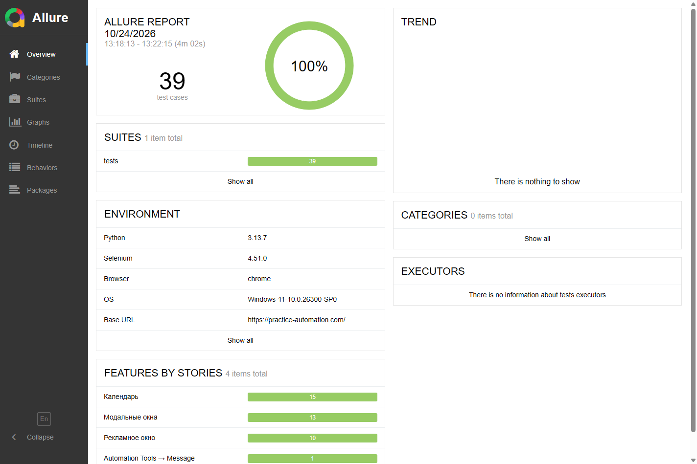

# Проверка проекта

Дата: 24 октября 2026 года. Проверялся реальный сайт https://practice-automation.com/.

| Окружение | Результат |
|---|---|
| Windows, Python 3.13.7, Selenium 4.51.0, Chrome 155.0.8059.86 / ChromeDriver 155.0.8059.84 | **39 passed**, 250,19 с, два worker-процесса |
| Windows, Python 3.13.7, Firefox 158.0.1 / GeckoDriver 0.37.1 | **39 passed**, 615,90 с, два worker-процесса |
| GitHub Actions, Ubuntu, Python 3.12.15, Chrome 155.0.8059.39 | **39 passed**, 0 failed / errors / skipped |
| GitHub Actions, Ubuntu, Python 3.12.15, Firefox 157.0 | **39 passed**, 0 failed / errors / skipped |
| Сборка HTML Allure 2.34.1 | Успешно |
| Ruff check и format | Успешно |
| pip check | Конфликтов зависимостей нет |

Основной поддерживаемый Python — 3.12+. Локальная проверка проведена на 3.13.7;
на Python 3.12.15 выполнены полные прогоны в двух браузерах в GitHub Actions.

[Успешный CI-прогон № 40081982088](https://github.com/BankaSTR/Volga-iT.ProkonovKirill_PIbd31/actions/runs/40081982088)
проверяет код коммита `bcc6580e9734e93cff50f761fc767e5181071e55`: lint и обе
браузерные задачи завершились со статусом success. Из CI скачаны оба артефакта;
счётчики отдельно сверены по JUnit XML и `widgets/summary.json` Allure.

Команда полного прогона Chrome:

```bash
python -m pytest --browser=chrome -n 2 --dist=loadfile \
  --alluredir=artifacts/final-chrome/allure-results \
  --junitxml=artifacts/final-chrome/junit.xml -q
```

Результаты содержат 39 отдельных записей Allure, осмысленные шаги, параметры
и реальные версии браузера/драйвера в capabilities. Для упавших при разработке
сценариев проверено наличие настоящих PNG-скриншотов, DOM и URL, в том числе
при ошибке подготовки страницы. Эти промежуточные неуспешные прогоны не смешиваются
с итоговыми отчётами. В окончательном наборе нет `skip`, `xfail` или автоперезапусков.



Исходные результаты и сгенерированные отчёты находятся в локальной папке `artifacts/`;
она исключена из Git вместе с окружениями и скачанными браузерами. После запуска
GitHub Actions отчёты доступны в артефактах workflow.
